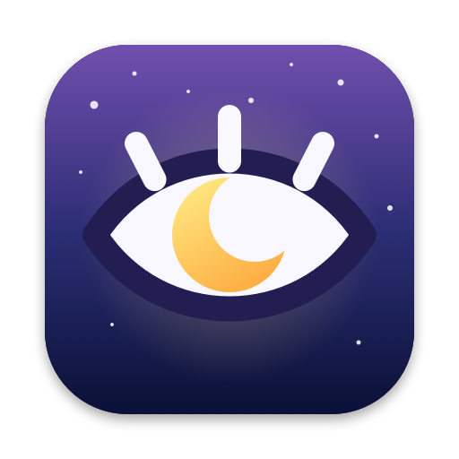
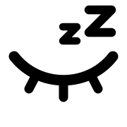
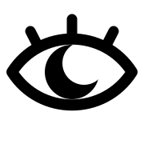
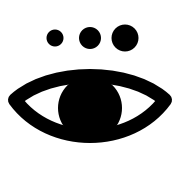

# Insomnia



Keep your MacBook working with the lid closed, without an external display, while macOS keeps managing the fans and thermal throttling. A watchdog puts the Mac to sleep if it gets too hot, the battery runs low, or a time limit passes.

It is built for leaving long jobs running (AI coding agents, builds, downloads, renders) while the laptop sits closed on a desk or stand. Optionally it also starts [Claude Code Remote Control](https://code.claude.com/docs/en/remote-control), so you can continue and **start new Claude Code sessions on your Mac from your phone** while the lid is shut.

| Off | On | Switching |
|---|---|---|
|  |  |  |

## What it does

- **Lid closed, still running.** `pmset -a disablesleep 1` stops lid-close sleep, and `caffeinate -ims` stops idle sleep. The display is allowed to turn off.
- **Cooling untouched.** Fans, SMC thermal control and CPU/GPU throttling are never changed. macOS cools the Mac exactly as with the lid open.
- **Watchdog.** Every 30 seconds it checks thermal pressure (`powermetrics`), battery temperature and battery level. It stops and puts the Mac to sleep when:
  - thermal pressure reaches Heavy or worse,
  - the battery passes 45 °C (`--max-temp`),
  - the charge drops under 20% on battery power (`--min-battery`),
  - the optional `--hours` limit runs out.
- **Always restores sleep.** Stopping it in any normal way (`insomnia off`, Ctrl+C, a tripped limit) switches normal sleep back on. Even a crash, a `kill -9` of the watchdog or a reboot mid-session can't leave sleep disabled: a small login agent (`insomnia heal-agent`, set up by the installer) runs `insomnia heal` at login and every minute, and if sleep is disabled with no watchdog alive it switches sleep back on (and sleeps the Mac if the lid is closed). Restoring on its own needs the no-password rule below; without it the agent notifies you instead.
- **Locks the screen when the lid closes** (menu bar app). A locked Mac keeps running everything; only sleep stops work.
- **Phone access** (optional). `--remote DIR` starts `claude remote-control` in DIR, so the Claude mobile app (Code tab) or claude.ai/code can open and create sessions that run on this Mac. Turning Insomnia off leaves phone access running, so phone chats stay connected while the Mac is awake. A battery guard stops phone access when the Mac is on battery below 20% (set `INSOMNIA_REMOTE_MIN_BATTERY` to change it), so it can never drain a forgotten laptop. If you use the Claude desktop app, also consider turning off its "Keep awake on battery power" setting.
- **Menu bar app.** Turn on, turn on with phone access in one of your recent Claude folders, turn off, lock, battery and temperature, and settings (Low Power Mode, time limit, worktrees per phone session, Open at Login).

## Requirements

- macOS 13 or newer on a MacBook. Tested on Apple Silicon (macOS 26).
- Xcode Command Line Tools for the menu bar app (`xcode-select --install`).
- For phone access: the [Claude Code CLI](https://code.claude.com/docs) signed in with a claude.ai Pro, Max, Team or Enterprise plan.

## Install

```bash
git clone https://github.com/ArtemKorchunov/insomnia.git ~/insomnia
cd ~/insomnia
./install.sh
```

That links the `insomnia` command into `~/.local/bin` and builds the menu bar app into `~/Applications/Insomnia.app`. Keep the cloned folder: the command points into it.

Options:

```bash
./install.sh --no-app     # only the command, no menu bar app
./install.sh --skill      # also install the Claude Code skill (see below)
```

### Optional: no password prompts

Changing sleep settings needs admin rights, so by default `on` and `off` ask for your password (Touch ID works in a terminal if you have enabled Touch ID for sudo). To switch without prompts:

```bash
insomnia install-nopasswd
```

This adds `/etc/sudoers.d/insomnia`, validated with `visudo`, that allows **only** the exact commands Insomnia runs (`pmset -a disablesleep 0|1`, `pmset sleepnow`, `pmset -b|-c powermode 0|1|2`, `pmset -a powermode 1`, and `powermetrics --samplers thermal -n 1 -i 1000`). The script itself never gets passwordless root. Remove it with `insomnia uninstall-nopasswd`.

The heal agent is a per-user LaunchAgent (`~/Library/LaunchAgents/com.oddproblems.insomnia.heal.plist`). Manage it with `insomnia heal-agent install|uninstall|status`. It treats any `disablesleep 1` without a running Insomnia watchdog as left over, so if you also set that by hand, uninstall the agent.

### Uninstall

```bash
./uninstall.sh
```

## Usage

```bash
insomnia on                                   # lid-closed mode, runs in the background
insomnia on --hours 3 --low-power             # stop after 3 hours, run cooler
insomnia on --remote ~/code/my-project        # plus Claude Code sessions from your phone
insomnia on --remote ~/code/my-project --remote-spawn worktree   # each phone session in its own git worktree
insomnia off                                  # normal sleep back (phone access keeps running)
insomnia off --all                            # also stop phone access
insomnia status                               # human-readable state
insomnia toggle
```

Logs: `/tmp/insomnia-watchdog.log` and `/tmp/insomnia-remote.log`.

## Using it with Claude Code

Two ways to let Claude drive it:

- **Skill:** `./install.sh --skill` installs `claude-skill/` as `~/.claude/skills/insomnia`. Claude then picks it up from phrases like "keep my Mac awake with the lid closed", "turn insomnia off", or "let me start Claude sessions from my phone".
- **Start plan:** [CLAUDE.md](CLAUDE.md) is a step-by-step plan Claude can follow to install, verify and use Insomnia on a new machine. Open Claude Code in the cloned folder and ask it to "set up Insomnia".

## Is running with the lid closed safe?

Short version: on a fan-cooled MacBook Pro on a hard surface or stand, yes, low risk. Apple supports lid-closed use in its own clamshell mode. Never run it closed in a bag or on a bed. Details and sources: [docs/closed-lid-safety.md](docs/closed-lid-safety.md).

## How it is built

```
scripts/insomnia.sh      the command: on/off, watchdog, Remote Control, state for the app
menubar/main.swift       the menu bar app (AppKit, no dependencies)
menubar/Icons.swift      menu bar and app icons
menubar/tools/main.swift renders the .icns and previews
menubar/build.sh         compiles and installs ~/Applications/Insomnia.app
claude-skill/SKILL.md    Claude Code skill
CLAUDE.md                install and usage plan for Claude
```

The open eye's iris is the Claude spark. The repo does not ship the logo: `menubar/build.sh` cuts it out of the Claude desktop app installed on your Mac (`/Applications/Claude.app`) at build time. Without the Claude app, the build falls back to a hand-drawn spark.

`pmset -a disablesleep` is undocumented by Apple. It has worked for years, but a future macOS could change it.

## License

MIT for the code in this repo.

Claude and the Claude logo are trademarks of Anthropic. Insomnia is an independent project, not made, endorsed or supported by Anthropic. The logo is not covered by the MIT license.
